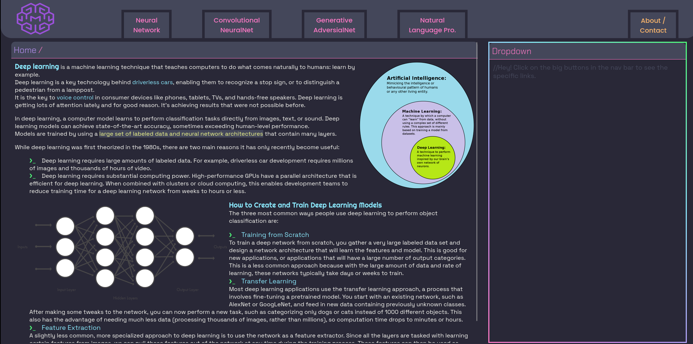

# [ModeLsmith](https://modelsmith.info) 


> A machine learning website based on Django for all of our ML projects.

> *Developers* : [Ankit Kumar](https://github.com/Anky209e),[Ashwani Ahlawat](https://github.com/AshuAhlawat)



> Project Directory Structure
```
.
├── app
│   ├── cnn
│   ├── gans
│   ├── media
│   ├── models
│   ├── modelsmith
│   ├── nn
│   └── templates
├── cnn
│   ├── classes
│   └── __pycache__
├── data
│   └── nlp
├── gans
│   ├── classes
│   ├── migrations
│   └── __pycache__
├── media
│   ├── gans_images
│   └── home
├── models
├── modelsmith
│   └── __pycache__
├── nlp
│   ├── classes
│   ├── migrations
│   └── __pycache__
├── nn
│   ├── classes
│   ├── migrations
│   └── __pycache__
└── templates
    ├── cnn
    ├── gans
    ├── home
    ├── nlp
    └── nn
```

## Setting up Environment and Running

```bash
cd /path/to/directory
python -m pip install -r requirements.txt
python manage.py runserver
```


## Containers

Docker Engine and Docker Compose are required. Run commands from the repository root.
Model weights must be present in `models/`; both setups mount them read-only.

### Development

```bash
docker compose -f docker-compose-dev.yml up --build
```

Open http://localhost:8000. Source changes reload automatically. The source tree,
SQLite database, and media remain on the host. The container defaults to UID/GID
1000; if yours differ, prefix the command with
`LOCAL_UID=$(id -u) LOCAL_GID=$(id -g)` so uploads and SQLite remain writable.
The development server binds to localhost on the host machine.

### Production

```bash
cp .env.example .env
python -c 'import secrets; print(secrets.token_urlsafe(64))'
```

Set `DOMAIN` in `.env` to your hostname (without a scheme or path), and paste the
generated value into `SECRET_KEY`. Keep the secret stable and do not commit `.env`.
Point the domain at the server and allow inbound ports 80 and 443, then run:

```bash
docker compose -f docker-compose.prod.yml up --build -d
docker compose -f docker-compose.prod.yml ps
docker compose -f docker-compose.prod.yml logs -f web caddy
```

Caddy obtains HTTPS certificates and serves media and collected static files.
Gunicorn is private to the Compose network. One worker and a 120-second timeout
are the initial defaults for the memory-heavy ML demos; tune after measuring.
Migrations and static collection must succeed before startup continues.

SQLite, media, static assets, and Caddy state use persistent named volumes.
The first start creates a new database rather than importing the repository's
`db.sqlite3`. Existing host uploads are not imported automatically. Back up any
existing deployment's database and media before switching configurations.
The image's bundled media populate a fresh media volume; subsequent image builds
do not overwrite an existing volume's files. Do not use `down -v` unless you
intend to delete stored data and certificate state.

The development and production stacks use separate Compose project names.
Dependencies are currently unpinned; a successful build does not establish
compatibility of every legacy PyTorch/Keras checkpoint. Verify each demo before
publishing the service.
